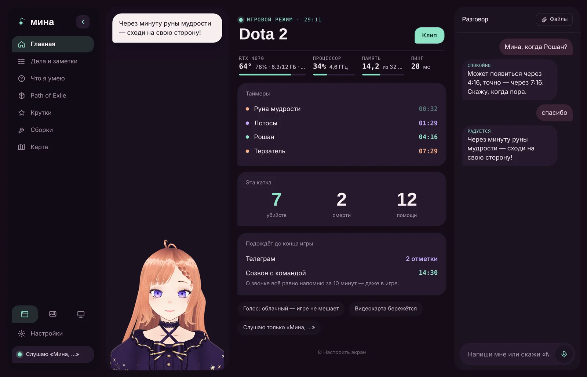
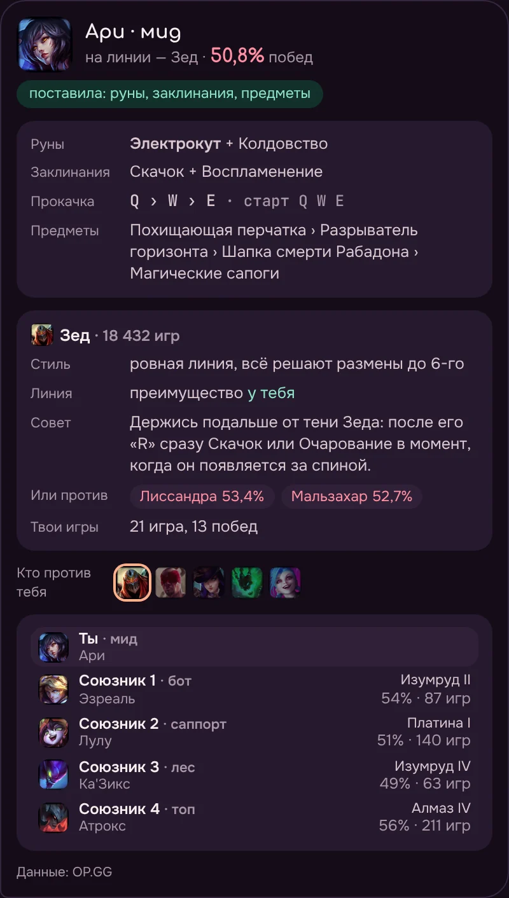
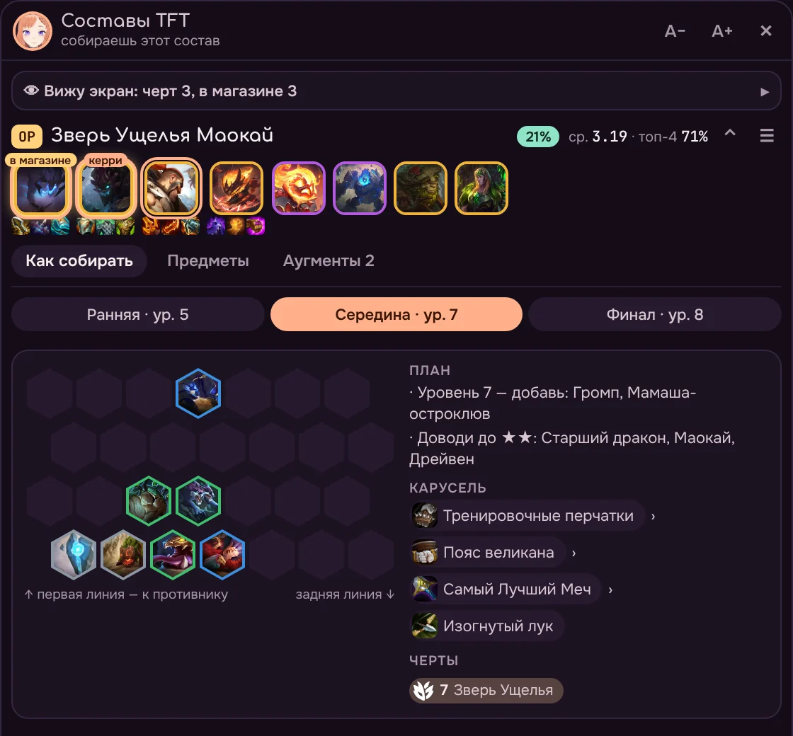
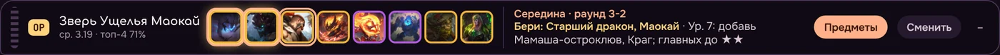
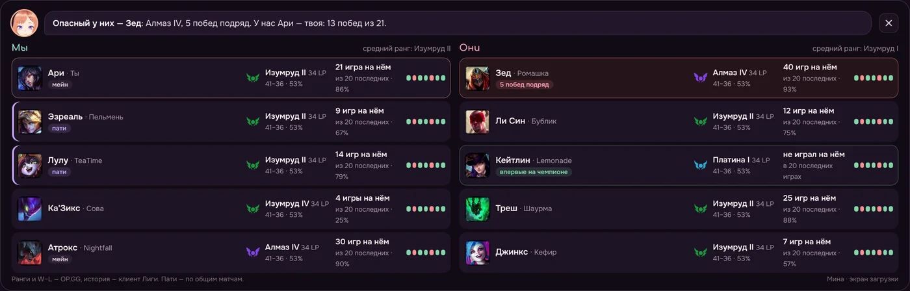
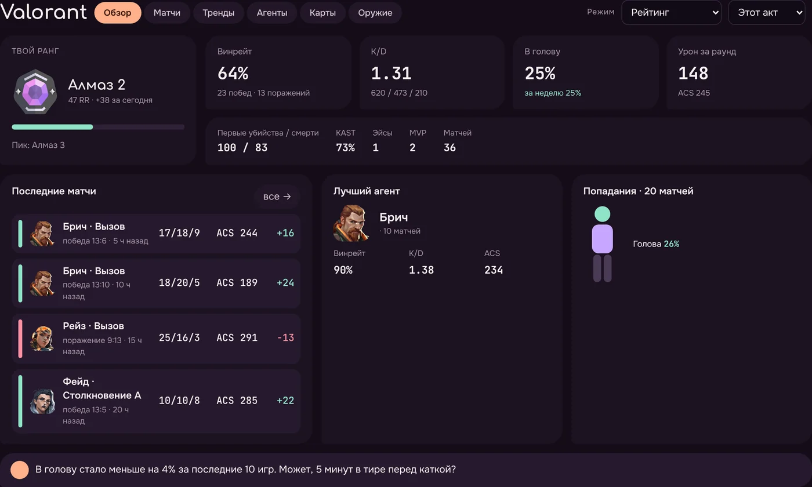
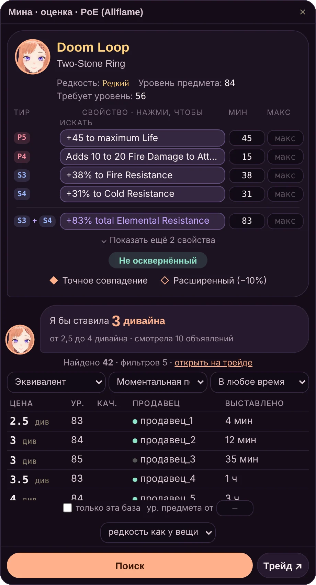
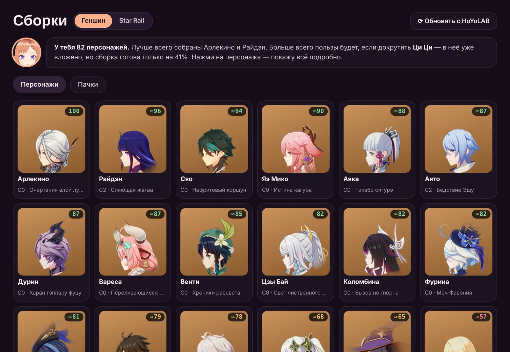
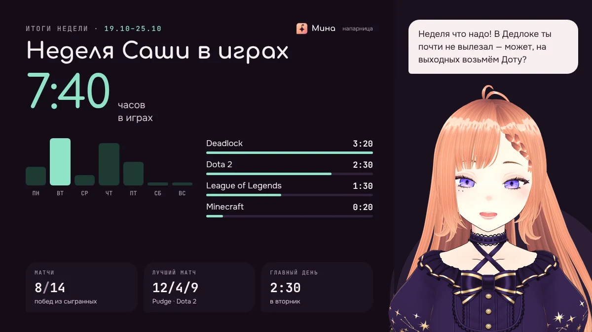

  

  <a href="https://github.com/RepoMina/mina/releases/latest"><b>⬇ Скачать для Windows</b></a>
  &nbsp;·&nbsp; <a href="https://mina-app.ru"><b>mina-app.ru</b></a>
  &nbsp;·&nbsp; бесплатно &nbsp;·&nbsp; Windows 10/11

  
  
  

---

**Мина** — живая 3D-девушка на твоём рабочем столе. Слышит голос, отвечает голосом, помогает с делами — а в играх подсказывает: таймеры, сборки, цены на предметы, ранги соперников и итоги вечера.

## Что она умеет

**🌙 Живёт на рабочем столе.** Гуляет по окнам, садится на панель задач, засыпает ночью, танцует под твою музыку и сама переодевается по погоде. Можно поселить её прямо на обоях.

**🎙 Разговаривает голосом.** Скажи «Мина, …» — и она ответит. Голоса на выбор: бесплатные (Светлана, Бая, Ксения), живые на видеокарте (Мина живая, Мина спокойная, Вивиан) или OpenAI / ElevenLabs по своему ключу. Напоминает о созвонах, переводит текст, пересказывает файлы и страницы, ведёт дела и заметки, читает Телеграм. Отправляет что-то только после твоего «да».

**🎮 Напарница в играх.** Своё окно поверх игры с таймерами, сборкой, железом и пингом; уведомления ждут конца матча; итоги вечера и недели — карточкой для друзей.

  

## Игры

| Игра | Что делает Мина |
|---|---|
| **Dota 2** | Таймеры рун, лотосов, Рошана и терзателя голосом, сборка на героя, разбор матча |
| **League of Legends** | Панель на выборе чемпиона: сборка и руны в клиент, матчап с соперником; ранги и форма обеих команд на загрузке; таймеры флешей соперников; трекер с графиком LP; аугменты для ARAM: Хаос |
| **TFT** | Сильные составы; в матче — полоса с составом и этапом, «что из чего собрать», подсветка нужных чемпионов в магазине. Всё прячется одной клавишей |
| **Path of Exile 1 и 2** | Оценка предмета по горячей клавише с тирами модов и ценой с трейда, рынок, лутфильтры NeverSink под текущую лигу |
| **Genshin · Star Rail · ZZZ** | Сборки с оценкой артефактов, пачки, крутки до гаранта, смола и ежедневная награда HoYoLAB, карта поверх игры |
| **Deadlock** | Сборки на героев по ступеням магазина, итог матча и ранг |
| **CS2 · Valorant** | Таймер бомбы и FACEIT; трекер Valorant — ранг, K/D, попадания, разбор каждого матча, прицелы |
| **И ещё** | Escape from Tarkov, Apex Legends, World of Warcraft, Warframe, Мир танков, Minecraft — и «Добавить игру» для любой другой |

  
  &nbsp;
  

  

  

  

  

  

Мина **ничего не нажимает в играх и ничего не покупает** — только голос и окна поверх игры. В память и файлы игр не лезет: только официальные и открытые данные, античит спокоен.

## С друзьями

**Дискорд** — заходит в голосовой канал, собирает пати, устраивает викторину. **Майнкрафт** — заходит отдельным игроком: ходит за тобой, добывает, приносит, защищает. Друзья общаются с ней как гости — твои настройки и данные им недоступны.

  

## Чем она думает и как звучит

Всё выбирается при первом запуске и меняется когда угодно. Можно целиком обойтись без подписок.

| Мозг | |
|---|---|
| **Бесплатно в облаке**, Groq, Z.AI, OpenRouter, Ollama Cloud | 0 ₽ — регистрация по почте, без карты |
| **Свой мозг** на твоём компьютере | 0 ₽ и без интернета |
| Подписка **Claude** Pro/Max, Claude, GPT или DeepSeek по ключу | по желанию — самые умные варианты |

| Голос | |
|---|---|
| **Бесплатный** — Светлана, Бая, Ксения | 0 ₽, лёгкие, не нагружают видеокарту — лучшие в играх |
| **Живой** — Мина живая, Мина спокойная, Вивиан | 0 ₽, на видеокарте NVIDIA от 6 ГБ: смеётся, шепчет, грустит |
| **По подписке** — OpenAI, ElevenLabs | по желанию, по своему ключу |

## Установка

1. Скачай `Mina-Setup-….exe` со страницы [последнего выпуска](https://github.com/RepoMina/mina/releases/latest) или на [mina-app.ru](https://mina-app.ru).
2. Запусти. Если Windows покажет «Windows защитила компьютер» — **«Подробнее» → «Выполнить в любом случае»**. Так бывает с программами от небольших авторов без платной подписи.
3. Права администратора не нужны. Ставится только Мина — без рекламы и чужих программ.
4. При первом запуске она один раз докачает нужное для работы (~300 МБ) и познакомится с тобой.

Обновления приходят сами — Мина предложит обновиться, когда выйдет новая версия.

**Нужно:** Windows 10 или 11 (64-бит), 8 ГБ памяти, интернет. Микрофон любой — или пиши Мине текстом. Для живого голоса — видеокарта NVIDIA от 6 ГБ.

## Приватность

- Настройки, память, заметки и ключи хранятся **только на твоём компьютере**, ключи — зашифрованы средствами Windows.
- Мина отправляет данные только в сервисы, которые ты сам подключил: выбранную нейросеть, голос, Телеграм, Дискорд, игровые сервисы.
- Экран смотрит только по твоей просьбе. Пароли и коды не вводит никогда.

## Связь и поддержка

- 🐞 Баг или идея — прямо из Мины: **Настройки → «Связь и поддержка»**, на странице [«Написать нам»](https://mina-app.ru/feedback.html) или на почту **minaapp@mail.ru**
- 💬 Вопросы — бот-помощник на [mina-app.ru](https://mina-app.ru), справа внизу
- ♥ Поддержать Мину — [Boosty](https://boosty.to/mina.app). Всё в Мине бесплатно, донат — по желанию

---

  © 2026 RepoMina. Все права защищены — Мину можно бесплатно использовать, но нельзя продавать и перезаливать. Подробно — в <a href="LICENSE">LICENSE</a>.

